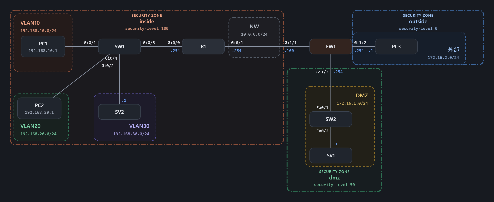

# ASAによる境界のアクセス制御(Packet Tracer)

Cisco Packet Tracer で、前回ルーター(R1)の拡張ACLで実装していた DMZ・外部との境界の通信制御を、ファイアウォール(ASA 5506-X)に移した検証環境です。

前回の構成:[network-acl-dmz](https://github.com/yasuzaki-ibuki/network-acl-dmz)

## 背景

前回の構成では、R1 の ACL2(外部側)・ACL3(DMZ側)で境界の通信を制御していました。しかし、ルーターの標準的なACLでは「社内から始めた通信の返事だけを通す」ことが完全にはできず、前回の README でも「完全に実現するにはステートフルなFW(ASAなど)が必要」と課題に挙げていました。

そこで今回は、境界に ASA を置き、セキュリティレベルとACLで制御する構成に作り直しました。

## 構成図

| ゾーン | セキュリティレベル | ネットワーク | 接続 | 機器 |
|---|---|---|---|---|
| inside | 100 | VLAN10 / 192.168.10.0/24 | SW1 → R1 Gi0/0.10 | PC1(社員PC) |
| inside | 100 | VLAN20 / 192.168.20.0/24 | SW1 → R1 Gi0/0.20 | PC2(管理用PC) |
| inside | 100 | VLAN30 / 192.168.30.0/24 | SW1 → R1 Gi0/0.30 | SV2(社内サーバー) |
| inside | 100 | 10.0.0.0/24(R1–ASA間) | R1 Gi0/1 → ASA Gi1/1 | - |
| dmz | 50 | 172.16.1.0/24 | ASA Gi1/3 → SW2 | SV1(公開Webサーバー) |
| outside | 0 | 172.16.2.0/24 | ASA Gi1/2 | PC3(外部) |

社内の3つのVLANとルーター・オン・ア・スティック構成は前回のままです。R1 の DMZ側・外部側のポートを外し、R1 と DMZ・外部の間に ASA を置きました。

## 要件

1. 社員PC・社内サーバー・ネットワーク機器の管理用で、ネットワークを分けること
2. 社員PCから社内サーバーへは、Web閲覧(HTTP)とpingのみ許可すること
3. 管理用ネットワークからは、すべての機器に接続できること
4. 社員PCから管理用ネットワークへは接続できないこと
5. DMZ・外部との通信ルール(下表)を、ASA で満たすこと

| 通信 | 結果 |
|---|---|
| 外部 → DMZのWebサーバー(HTTPのみ) | 許可 |
| 外部 → 社内LAN | 拒否 |
| 社内LAN → DMZ | 許可 |
| DMZ → 社内LAN(新規の通信) | 拒否 |

要件1〜4は前回と同じく R1 で、要件5は ASA で実現しています。

## 前回からの変更点

| 項目 | 前回(ルーターACL版) | 今回(ASA版) |
|---|---|---|
| 境界の制御 | R1 の ACL2・ACL3 | ASA のセキュリティレベルとACL |
| R1 の ACL2・ACL3 | 外部側・DMZ側のポートに適用 | 削除(境界の制御は ASA に一本化) |
| R1 の ACL1(社員PC) | あり | 変更なし(社内同士の通信は ASA を通らないため) |
| ルーティング | すべて R1 の直結ネットワーク | R1・ASA にスタティックルートを追加 |
| DMZ・外部のゲートウェイ | R1(.254) | ASA(.254)。アドレスは変えず、ホスト側の設定変更を不要にした |

## ACLの適用箇所(ASA)

| ACL | 適用インターフェース | 方向 | 役割 |
|---|---|---|---|
| ACL1 | dmz(Gi1/3) | in | SV1 からの通信のうち、返事だけを通す(※) |
| ACL2 | outside(Gi1/2) | in | 外部から SV1 への HTTP を許可。あわせて管理用からPC3へのpingの返事を通す(※) |

※ 返事を通す行は、Packet Tracer の制限を補うためのものです(後述)。本物の ASA では不要です。

R1 の ACL1 は前回から変更していません。詳細は [parameter-sheet.md](parameter-sheet.md)、試験結果は [test-results.md](test-results.md) を参照。

## 要件にない部分の設計判断

パラメータシートでは該当箇所に ★ を付けています。

| 項目 | 判断した内容 | 理由 |
|---|---|---|
| R1–ASA間のネットワーク | 10.0.0.0/24(R1=.254、ASA=.100) | 既存のどのネットワークとも重ならない中継用ネットワークとした。2台しかつながらないため、現場では /30 などの小さいネットワークにすることも多い |
| ASA の DMZ側・外部側のアドレス | 前回 R1 が使っていた .254 を引き継いだ | 前回の「ゲートウェイは .254」の方針を守り、SV1・PC3 の設定を変えずに済むようにするため |
| セキュリティレベル | inside=100、dmz=50、outside=0 | 信頼度の順(社内 > 自社管理だが外部公開あり > 外部)にした |
| R1 の ACL2・ACL3 | 削除 | 境界の制御を ASA に一本化するため。残すと、ASA 経由で戻ってくる通信を誤って止めてしまう |
| R1 の経路 | DMZ・外部を1行ずつ、次ホップ 10.0.0.100 で設定 | 出力インターフェース指定だと ARP の解決を ASA に頼ることになるため、次ホップのIPで指定した |
| 外部 → SV1 の送信元 | 外部ネットワーク(172.16.2.0/24)に限定 | この検証では外部=172.16.2.0/24 のため。現場の公開Webサーバーでは送信元を any にするのが一般的 |

## 設計のポイント

### セキュリティレベルで基本の方向を決め、例外だけACLに書く

ASA は、ACL がなくても「セキュリティレベルの高い側 → 低い側」の通信は通し、「低い側 → 高い側」は止めます。そのため、要件の「外部 → 社内LAN 拒否」「DMZ → 社内LAN 拒否」はセキュリティレベルだけで満たせます。ACL に書くのは、低い側から高い側へ通したい「外部 → DMZ の HTTP」だけ、というのが本来の設計です。

### ポートにACLを付けると、そのポートから出発する通信も制限される

ASA はポートに ACL を付けると、セキュリティレベルによる「高 → 低は通す」が効かなくなり、ACL に書いた通信以外はすべて止めます。dmz に ACL1 を付けたため、SV1 から外部への返事(PC3 → SV1 の HTTP の戻り)も ACL1 に書く必要がありました。

### 社内同士の通信は R1、境界は ASA

社員PC → 社内サーバーなど、社内のVLAN同士の通信は ASA を通らないため、要件2・4 は引き続き R1 の ACL1 が担当します。役割を「社内の制御は R1、境界の制御は ASA」と分けました。

## Packet Tracer の制約

### 返事の通信が自動で通らない

本物の ASA はステートフルなので、社内から出ていった通信の返事は自動で通します。しかし Packet Tracer の ASA 5506-X では、社内 → DMZ の HTTP の返事が「低いセキュリティレベル → 高いレベル」として止められました。シミュレーションモードで、ASA が返事を破棄している理由を確認しています。

NAT や `inspect http` を追加しても改善しなかったため、返事のパケット(送信元=サーバーの80番、宛先=社内)を ACL で直接許可して補いました。

ただし、ACL で返事を許可する方法は、本当の返事でなくても「送信元ポートが80番」なら通してしまうため、現場では使わない設定です。本物の ASA であれば、ACL1 は不要で、ACL2 は「外部 → SV1 の HTTP」の1行だけになります。

### ping の返事

ping(ICMP)は本物の ASA でも、初期設定では返事を覚えないため、`inspect icmp` などの設定が必要です。今回は上記と同じく、返事(echo-reply)を ACL で許可しました。

## 制約・今後の課題

- 返事を ACL で許可しているため、本物の ASA と同じ「ステートフルな」動作の検証にはなっていません。実機や別のシミュレーター(GNS3 など)での検証を今後の課題とします
- 管理用ネットワークから ASA 自体への管理接続(SSH など)は未対応です

## 使用ツール

- Cisco Packet Tracer 9.0.1
- ASA 5506-X(ASA Version 9.6(1))
